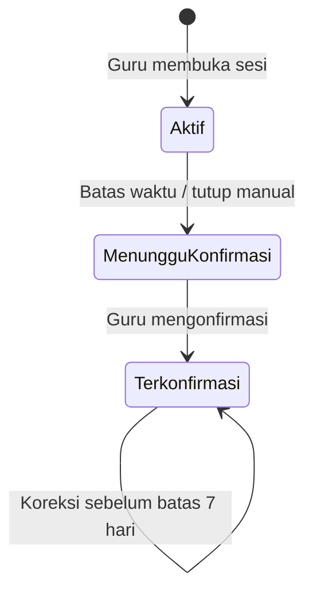

# Absensi SMAN 2 Rantau Selatan

Aplikasi absensi siswa dengan dua peran: **Guru** dan **Siswa**. Semua tampilan menggunakan Bahasa Indonesia. Dibangun dari skeleton resmi Laravel dengan pola halaman React/Inertia starter kit; pendaftaran guru publik sengaja tidak dipasang.

> **Batas autentikasi siswa:** login NISN saja, tanpa password/PIN, merupakan keputusan produk. Orang yang mengetahui NISN siswa lain dapat menyamar sebagai siswa tersebut. Rate limiting, HTTPS, CSRF, cookie HttpOnly, regenerasi session, dan pembatasan data tidak membuktikan identitas pemilik NISN. Guru tetap perlu memeriksa dan mengonfirmasi hasil kehadiran.

## Fitur

- Login guru melalui email/password, provisioning dan reset password melalui terminal server.
- Login siswa hanya dengan NISN aktif; sesi guru/siswa terpisah secara logis.
- Dashboard, tema terang/gelap, navigasi responsif, timer WIB, dan pengumuman keberhasilan setelah server menyimpan data.
- Daftar kelas dan siswa bersama; tambah, koreksi, pindah kelas, nonaktifkan siswa, dan audit perubahan.
- Template Excel `.xlsx`, pratinjau 15 menit, validasi baris, deteksi duplikat, impor baris valid dalam satu transaksi.
- Sesi fleksibel tanpa jadwal, snapshot peserta/nama/NISN/kelas, durasi default 5 menit (1-120 menit).
- Kiriman Hadir/Izin/Sakit satu kali per siswa; Alpa ditetapkan saat sesi tutup.
- Penutupan manual atau otomatis; scheduler dan pemeriksaan kedaluwarsa pada request terkait.
- Konfirmasi guru; hasil resmi dan PDF hanya berasal dari sesi terkonfirmasi.
- Koreksi hingga tepat sebelum 7 hari sejak penutupan; audit status dan keterangan. Konfirmasi tanpa perubahan tetap boleh setelah masa koreksi.
- Riwayat berfilter, statistik berdasarkan jumlah **catatan kehadiran**, PDF A4 per sesi/periode.
- Absensi via Link: formulir publik tanpa login, QR Code, durasi, rekap terpisah, dan PDF.
- Tidak ada admin, pendaftaran guru publik, jadwal, nilai, GPS, atau modul SIAKAD.

## Absensi via Link dan QR Code

Modul ini berjalan terpisah dari absensi berdasarkan NISN. Respons publik disimpan dalam `public_attendance_forms` dan `public_attendance_submissions`, tanpa membuat akun/siswa, mengubah roster, atau menambah statistik `attendance_records`.

1. Login sebagai guru, buka **Absensi via Link** di sidebar atau **Via Link** pada navigasi bawah ponsel.
2. Pilih **Buat Link Absensi**, isi judul maksimal 150 karakter dan durasi. Default 30 menit; preset 5/10/15/30/60/120 menit; durasi khusus 1–1.440 menit.
3. Tekan **Generate Link & QR Code**. Masa aktif dimulai saat server membuat formulir.
4. Tekan **Salin Link** atau **Unduh QR Code**. QR berupa SVG beresolusi bebas dengan area putih di sekelilingnya, dibuat lokal memakai `qrcode.react` tanpa layanan QR eksternal. Link dan QR tidak berubah saat halaman dibuka ulang.
5. Siswa membuka `/form-absensi/{token}` tanpa login/NISN, mengisi nama, kelas, pelajaran, les ke-1 sampai ke-20, status Hadir/Izin/Sakit/Alpa, dan keterangan opsional. Tanggal serta jam WIB ditampilkan otomatis; timestamp resmi selalu dicatat server dalam UTC saat menerima kiriman.
6. Setelah **Simpan Absensi** berhasil, siswa mendapat konfirmasi di halaman yang sama. Memuat ulang halaman menampilkan tanda terima miliknya pada sesi browser tersebut.
7. Guru memilih **Lihat Respons**. Tersedia pencarian nama, filter kelas/status/tanggal, pagination, indikasi kemungkinan duplikat, statistik, dan pembaruan otomatis setiap 10 detik selama formulir aktif. Polling mempertahankan filter.
8. Pilih **Unduh PDF** untuk rekap A4 landscape sesuai filter. Hanya guru pemilik yang dapat membuka detail, rekap, dan PDF; respons tetap tersedia setelah kedaluwarsa. Unduhan dibatasi 5.000 respons per PDF.

Dropdown kelas menggabungkan X-1 sampai XII-8 dengan kelas aktif yang tersedia, tanpa duplikasi dan tanpa bergantung pada isi tabel siswa. Formulir tidak memerlukan pembuatan kelas atau impor roster.

Server menolak pengiriman baru ketika `now >= expires_at`, termasuk formulir yang sudah terbuka sebelum batas waktu. Countdown hanya indikator visual dan formulir otomatis berganti menjadi halaman berakhir. Tidak diperlukan scheduler untuk modul publik ini. Retry atas kiriman yang sudah berhasil tetap mengembalikan keberhasilan tanpa menambah respons; key yang sama dengan data berbeda ditolak.

**Batas pengisian anonim:** siapa pun yang mempunyai link dapat mengisi. Sistem tidak memverifikasi identitas siswa dan tidak menjamin satu siswa hanya mengisi sekali. Tombol proses, idempotency key unik per formulir, transaksi dengan row lock, CSRF, validasi, honeypot, dan rate limiting mengurangi kesalahan/spam; semuanya tidak membuktikan identitas. Nama yang dinormalisasi dan kelas yang sama ditandai untuk ditinjau, bukan diblokir mutlak. Rate limit 60 kiriman/menit per IP+form dan 300/menit per IP; respons publik tidak dapat dilihat pengunjung lain. Halaman publik menggunakan `noindex`, `no-store`, dan kebijakan referrer terbatas.

Untuk dibuka dari HP lain, gunakan alamat situs yang dapat dijangkau perangkat itu. `127.0.0.1`/`localhost` hanya menunjuk perangkat yang membuka link. Pada jaringan lokal, jalankan `php artisan serve --host=0.0.0.0`, akses lewat IP LAN komputer pada jaringan yang sama, lalu buat/salin link dari alamat tersebut. Pada server gunakan domain HTTPS aktual dan atur `APP_URL`; pastikan port/jaringan dapat dijangkau. Membuka firewall atau deployment tidak dilakukan otomatis.

### Pembaruan instalasi tanpa menghapus data

```powershell
npm ci
php artisan migrate
npm run build
php artisan serve
```

Migration baru `2026_10_19_150535_create_public_attendance_tables.php` hanya menambahkan dua tabel beserta indeks, foreign key, status terbatas, dan constraint idempotency. Tidak mengubah tabel absensi lama. Jangan menggunakan perintah reset database untuk pembaruan ini. Tidak ada dependency Composer tambahan; `jsqr` merupakan dependency pengujian untuk membaca balik QR unduhan dan memastikan URL-nya benar.

## Stack dan kebutuhan

| Komponen | Versi/pilihan |
| --- | --- |
| PHP | 8.4+, ekstensi ctype, curl, dom, fileinfo, gd, intl, mbstring, openssl, PDO MySQL, XML, zip |
| Backend | Laravel 13, Eloquent, session database, Form Requests, Policies |
| Frontend | React 19, TypeScript, Inertia 2, Vite 7 |
| UI | Tailwind CSS 4, komponen shadcn/ui Button dan Dialog berbasis Radix, Lucide, Motion |
| Database produksi | MySQL 8.0+ (InnoDB, utf8mb4) |
| Excel / PDF | PhpSpreadsheet 5 / Laravel DomPDF 3 |
| Pengujian | PHPUnit 12, Playwright dengan Chrome |
| Peralatan | Composer 2, Node.js 22.12+ atau 24 LTS, npm |

Dependensi dikunci dalam `composer.lock` dan `package-lock.json`. PHP portabel lokal yang disiapkan adalah 8.4.26; PHP 8.2 XAMPP tidak diubah. Server database yang tersedia dan diuji di komputer ini adalah **MariaDB 10.4.32 melalui driver mysql**. MySQL 8 murni belum diuji pada mesin ini.

## Jalankan pada workspace yang sudah disiapkan

Database `absensi_sman2`, `.env`, application key, dependensi, migrasi, dan build frontend sudah disiapkan. Database aplikasi dimulai kosong; akun dan data browser pengujian berada pada database lain.

PowerShell, dari folder proyek:

```powershell
cd D:\Project\ABSENSI-SMAN2
# Buat akun guru pertama. Nama, email, dan password ditanyakan secara interaktif.
php artisan teacher:create
# Jalankan aplikasi dengan aset yang sudah dibangun.
php artisan serve
```

Cukup jalankan `php artisan serve`, termasuk di Git Bash yang masih memilih PHP 8.2 XAMPP. Entry point `artisan` akan meneruskan perintah ke PHP 8.4 portabel dalam `.runtime/php` sebelum memuat Composer. Tidak perlu mengubah PATH atau membuka ulang terminal untuk proyek ini.

Buka **http://127.0.0.1:8000**. Di terminal kedua:

```powershell
cd D:\Project\ABSENSI-SMAN2
php artisan schedule:work
```

Tidak ada kredensial guru bawaan. Setelah login, buka **Data Siswa**, tambahkan kelas dan siswa, lalu tekan **Mulai Absensi**. Siswa membuka `/siswa/masuk` menggunakan NISN yang terdaftar.

## Instalasi baru di Windows

1. Pasang Node.js dan Composer; nyalakan database MySQL/MariaDB. Visual C++ Redistributable x64 diperlukan untuk PHP Windows.
2. Jalankan skrip berikut. Skrip memasang PHP 8.4 portabel di `.runtime/php` jika belum tersedia, memverifikasi SHA-256 dari metadata resmi PHP, lalu memasang dependensi. PATH global dan XAMPP tidak diubah.

```powershell
powershell -ExecutionPolicy Bypass -File .\scripts\setup-windows.ps1
```

3. Buat database dan akun dengan hak terbatas melalui klien database Anda:

```sql
CREATE DATABASE absensi_sman2 CHARACTER SET utf8mb4 COLLATE utf8mb4_unicode_ci;
CREATE USER 'absensi'@'localhost' IDENTIFIED BY 'GANTI_DENGAN_PASSWORD_KUAT';
GRANT ALL PRIVILEGES ON absensi_sman2.* TO 'absensi'@'localhost';
```

4. Sesuaikan `.env` (jangan masukkan ke Git):

```dotenv
DB_CONNECTION=mysql
DB_HOST=127.0.0.1
DB_PORT=3306
DB_DATABASE=absensi_sman2
DB_USERNAME=absensi
DB_PASSWORD=isi_password_database_anda
```

`.env` lokal workspace ini menggunakan akun root XAMPP tanpa password yang sudah tersedia, khusus pengembangan lokal. Ganti dengan akun database khusus untuk server produksi.

5. Siapkan aplikasi:

```powershell
.\.runtime\php\php.exe artisan key:generate
.\.runtime\php\php.exe artisan migrate
.\.runtime\php\php.exe artisan db:seed
.\.runtime\php\php.exe artisan teacher:create
npm.cmd run build
```

`DatabaseSeeder` sengaja kosong sehingga tidak membuat akun dengan password bawaan. Factory disediakan untuk pengujian. Jangan menjalankan `migrate:fresh` pada database yang berisi data nyata.

Untuk perubahan frontend, jalankan `npm.cmd run dev` di terminal lain. Untuk menggunakan hasil build, hentikan Vite dan pastikan `public/hot` tidak tersisa setelah Vite berhenti tidak normal.

## Akun guru dan pemulihan password

```powershell
.\.runtime\php\php.exe artisan teacher:create
.\.runtime\php\php.exe artisan teacher:reset-password
```

Keduanya memerlukan akses terminal server. Password dimasukkan melalui prompt tersembunyi, tanpa batas minimal panjang atau kewajiban kombinasi huruf/angka; password tetap wajib diisi pada pembuatan/reset akun, dan disimpan sebagai hash. Reset password mencabut sesi lama ketika request berikutnya memeriksa fingerprint password. Pengaturan profil memerlukan password saat ini. Tidak ada reset melalui email karena layanan email belum dikonfigurasi.

## Impor siswa dari Excel

1. Buka Data Siswa, lalu unduh **Template Excel**.
2. Gunakan header persis `NISN` dan `Nama Lengkap`. Hapus/ganti baris contoh sebelum mengunggah.
3. Isi NISN 10 digit sebagai **teks**, termasuk nol awal. Template sudah memformat kolom NISN sebagai teks. Angka yang sudah kehilangan nol awal ditolak; aplikasi tidak menebak NISN.
4. Pilih kelas tujuan, unggah `.xlsx` maksimal 2 MB / 5.000 siswa, lalu pilih **Periksa File**.
5. Periksa seluruh pratinjau. Baris kosong diabaikan; nama tanpa huruf, rumus, NISN tidak valid, dan NISN duplikat ditandai.
6. Konfirmasi impor baris valid. Semua baris valid disimpan sekaligus dalam satu transaksi; baris tidak valid/duplikat dilewati dengan ringkasan jumlah.

Tidak ada data lama yang ditimpa. Bila NISN baru masuk melalui request lain setelah pratinjau, seluruh batch dibatalkan dan perlu diunggah ulang. Pratinjau disimpan di cache server, dibatasi guru dan session yang membuatnya, berlaku 15 menit; data kiriman browser tidak dipercaya untuk commit. Hanya sheet pertama yang dibaca. `.xls`, `.xlsm`, CSV, dan rumus tidak didukung. Ukuran XML terurai dan jumlah baris/kolom juga dibatasi.

Perubahan nama, NISN, kelas, dan status aktif siswa dicatat pada `student_change_logs`. Nonaktifkan siswa untuk mempertahankan riwayatnya; tidak tersedia operasi hapus siswa.

## Aturan sesi dan konsistensi data



- Semua timestamp database menggunakan **UTC**. Tampilan dan filter tanggal menggunakan **Asia/Jakarta (WIB)**. Sebuah tanggal filter mencakup 00:00-23:59:59 WIB, bukan hari kalender UTC.
- Daftar peserta disalin saat sesi dibuat. Siswa pindah kelas atau berubah nama tidak mengubah sejarah. Siswa tambahan setelah sesi dimulai menunggu sesi berikutnya.
- Setiap workflow mengambil lock baris sesi terlebih dahulu, lalu lock catatan peserta, dalam transaksi dengan retry deadlock. Constraint unik `(attendance_session_id, student_id)` menjadi perlindungan tambahan.
- Server memeriksa waktu setelah lock diperoleh. Kiriman tepat pada atau setelah `ends_at` ditolak. Timer browser hanya tampilan.
- Penutupan hanya mengisi status catatan yang masih kosong. Kiriman valid sebelumnya tidak ditimpa. Penutupan berulang idempoten.
- Waktu tutup otomatis efektif adalah `ends_at` meskipun scheduler terlambat. Waktu tutup manual adalah waktu server ketika guru menutup sebelum deadline.
- Koreksi diizinkan pada `now < closed_at + 7 hari`; tepat pada deadline sudah terkunci. Setiap perubahan status/keterangan dicatat. Konfirmasi tanpa mengubah data tetap diperbolehkan setelah deadline.
- Guru hanya dapat membaca/mengubah/mengekspor sesi miliknya. Identitas siswa selalu ditentukan dari guard session, bukan ID kiriman frontend.
- Statistik/PDF resmi menggunakan hasil terkonfirmasi; kiriman yang masih menunggu diperlihatkan terpisah. PDF menampilkan satu baris per catatan sesi sehingga siswa yang hadir di beberapa sesi tetap memiliki beberapa baris.
- PDF dibatasi 5.000 catatan per unduhan untuk menjaga penggunaan memori. Persempit periode bila melampaui batas.

## Scheduler

Lokal:

```powershell
.\.runtime\php\php.exe artisan schedule:work
# Rekonsiliasi satu kali untuk pemeriksaan:
.\.runtime\php\php.exe artisan attendance:expire
.\.runtime\php\php.exe artisan schedule:list
```

Cron Linux, sebagai pengguna yang memiliki akses aplikasi:

```cron
* * * * * cd /var/www/absensi && /usr/bin/php8.4 artisan schedule:run >> /dev/null 2>&1
```

Scheduler berjalan setiap menit dengan `withoutOverlapping`. Dashboard, detail, dan permintaan absensi juga memeriksa kedaluwarsa, sehingga scheduler yang terhenti tidak membuka peluang kiriman terlambat. Cron tetap dibutuhkan untuk merekonsiliasi sesi ketika tidak ada pengunjung.

## Pengujian

Unit/feature default memakai SQLite in-memory; ekstensi SQLite hanya diperlukan untuk suite ini. Seluruh test frontend terhubung ke backend nyata.

```powershell
.\.runtime\php\php.exe artisan test
npm.cmd run types:check
npm.cmd run build
```

Untuk integrasi database, buat database khusus **absensi_sman2_test**. Konfigurasi host/user/password mengikuti `.env`, nama database di-override oleh konfigurasi PHPUnit. Suite menolak database non-SQLite yang namanya tidak berakhiran `_test`.

```sql
CREATE DATABASE absensi_sman2_test CHARACTER SET utf8mb4 COLLATE utf8mb4_unicode_ci;
CREATE DATABASE absensi_sman2_browser_test CHARACTER SET utf8mb4 COLLATE utf8mb4_unicode_ci;
```

```powershell
.\.runtime\php\php.exe vendor/phpunit/phpunit/phpunit -c phpunit.mysql.xml
.\.runtime\php\php.exe vendor/phpunit/phpunit/phpunit -c phpunit.concurrency.xml
npm.cmd run test:e2e
```

Suite feature memakai migrasi additive dan transaksi yang di-rollback per test; gunakan database pengujian kosong, bukan salinan data nyata. Tidak menjalankan reset database. Suite concurrency memakai dua proses PHP nyata dan membuat database terisolasi baru untuk setiap test. Playwright memakai Chrome yang terpasang, server sementara port **8001**, database baru bernama `absensi_sman2_browser_<acak>_test`, serta password acak setiap eksekusi. Akun database lokal pengujian memerlukan izin membuat database. Jika mengisi `E2E_DB_DATABASE` sendiri, sediakan database khusus yang kosong; setup menolak menimpa data pengujian sebelumnya. Database pengujian disisakan untuk inspeksi, tanpa menghapus database atau data lama. Jangan arahkan pengujian ke database produksi. Pada Linux pasang Chrome atau ubah `channel` di `playwright.config.ts` ke browser CI yang tersedia. Runtime PHP Windows untuk Playwright diambil dari `.runtime/php/php.exe`; Linux menggunakan PHP pada PATH.

Pengujian fitur link mencakup validasi, waktu server/UTC/WIB, deadline, idempotency, kepemilikan guru, filter/pagination, PDF panjang, batas ukuran request, rate limit, serta pemisahan data lama. E2E mencakup pengisian tanpa login, CSRF, clipboard, pembacaan balik QR unduhan menggunakan `jsqr`, polling dengan filter, PDF, tema, dan ukuran layar 360/390/768/1024/1440 piksel.

Lihat `docs/verification.md` untuk hasil eksekusi dan batas pemeriksaan. Screenshot/PDF pengujian disimpan di `.runtime/screenshots` yang diabaikan Git.

## Deploy Linux dengan domain pribadi

Tidak ada deployment eksternal yang dilakukan. Contoh Nginx tersedia di `docs/deployment-nginx.conf`; sesuaikan domain, certificate, direktori, dan socket PHP.

1. Pasang PHP 8.4-FPM dengan ekstensi di atas, MySQL, Nginx, Composer, dan Node.js.
2. Salin source, `.env` khusus server, lalu jalankan:

```bash
composer install --no-dev --prefer-dist --optimize-autoloader
npm ci
npm run build
php artisan key:generate # hanya saat instalasi baru; simpan key untuk database/session yang sudah ada
php artisan migrate --force
php artisan teacher:create
php artisan optimize
```

3. Atur:

```dotenv
APP_ENV=production
APP_DEBUG=false
APP_URL=https://absensi.domain-sekolah-anda.sch.id
SESSION_DRIVER=database
SESSION_ENCRYPT=true
SESSION_SECURE_COOKIE=true
SESSION_HTTP_ONLY=true
SESSION_SAME_SITE=lax
```

4. Arahkan document root ke **public/**, bukan root proyek. Source, `.env`, log, dan storage tidak boleh bisa diunduh. HTTPS wajib; gunakan sertifikat valid dan redirect HTTP ke HTTPS. Aplikasi memaksa URL HTTPS dan cookie secure pada produksi. Saat memakai reverse proxy, konfigurasikan hanya alamat proxy tepercaya sesuai jaringan server; tidak ada wildcard trust proxy bawaan.
5. Beri write permission pada `storage` dan `bootstrap/cache` kepada pengguna PHP-FPM. Contoh: `chown -R www-data:www-data storage bootstrap/cache` dan permission direktori 775/file 664 sesuai kebijakan server. Jangan gunakan 777.
6. Atur PHP `upload_max_filesize=3M`, `post_max_size=4M`, dan `memory_limit=512M` serta `client_max_body_size` Nginx yang sesuai.
7. Pasang cron scheduler. Pantau log internal dan disk, gunakan backup MySQL terenkripsi terjadwal serta uji pemulihan. Simpan kredensial backup pada file konfigurasi server berpermission ketat, bukan argumen shell/riwayat terminal. Backup juga `.env`/APP_KEY secara aman.
8. Jalankan ulang `php artisan optimize` setelah perubahan konfigurasi; `php artisan optimize:clear` untuk membersihkan cache konfigurasi sebelum investigasi.

Tidak diperlukan Redis, WebSocket, queue worker, Docker, microservice, storage publik, atau `storage:link` untuk fitur saat ini.

## Struktur penting

```text
app/Http/Controllers/       Login, guru, siswa, roster, PDF, pengaturan
app/Http/Requests/          Validasi input dan izin awal
app/Http/Middleware/        Isolasi guard, data Inertia
app/Models/                Relasi dan snapshot
app/Policies/              Kepemilikan sesi guru
app/Services/              Transaksi absensi, import, query laporan
app/Console/Commands/       Provisioning dan reset guru
routes/                    Endpoint web dan scheduler
resources/js/pages/        Halaman React guru, siswa, publik
resources/js/components/   Form, timer, status, dialog, navigasi
resources/css/             Tema responsif dan reduced motion
resources/views/reports/   Template PDF A4
lang/id/                   Pesan validasi Bahasa Indonesia
database/                  Migrasi, factory, seeder kosong
tests/                     Feature, impor, PDF, concurrency, browser
docs/                      Verifikasi dan contoh konfigurasi produksi
scripts/                   Setup PHP dan peluncur Windows
```

## Referensi teknis

Dokumentasi diperiksa melalui Context7 saat implementasi: [Laravel 13](https://laravel.com/docs/13.x), [locking database](https://laravel.com/docs/13.x/queries#pessimistic-locking), [scheduler](https://laravel.com/docs/13.x/scheduling), dan [Inertia 2](https://inertiajs.com/docs/v2). Konfigurasi ringan ini memakai Inertia 2 stabil yang terverifikasi kompatibel dengan dependensi terpasang, tanpa modul autentikasi publik dari starter kit.

## Berkas implementasi Absensi via Link

Berkas baru (29):

```text
app/Http/Controllers/PublicAttendanceController.php
app/Http/Controllers/TeacherPublicAttendanceController.php
app/Http/Middleware/PublicAttendanceHeaders.php
app/Http/Requests/PublicAttendanceReportRequest.php
app/Http/Requests/StorePublicAttendanceFormRequest.php
app/Http/Requests/SubmitPublicAttendanceRequest.php
app/Models/PublicAttendanceForm.php
app/Models/PublicAttendanceSubmission.php
app/Policies/PublicAttendanceFormPolicy.php
app/Services/PublicAttendanceReportService.php
app/Services/PublicAttendanceService.php
database/factories/PublicAttendanceFormFactory.php
database/factories/PublicAttendanceSubmissionFactory.php
database/migrations/2026_10_19_150535_create_public_attendance_tables.php
resources/css/public-attendance.css
resources/js/components/public-attendance.tsx
resources/js/layouts/public-attendance-layout.tsx
resources/js/lib/public-attendance.ts
resources/js/pages/public-attendance/form.tsx
resources/js/pages/public-attendance/notice.tsx
resources/js/pages/teacher/public-attendance/create.tsx
resources/js/pages/teacher/public-attendance/index.tsx
resources/js/pages/teacher/public-attendance/responses.tsx
resources/js/pages/teacher/public-attendance/show.tsx
resources/views/reports/public-attendance.blade.php
tests/Feature/PublicAttendanceTest.php
tests/RefreshDatabaseWithoutReset.php
tests/e2e/public-attendance.spec.ts
tests/helpers/public-race-worker.php
```

Berkas lama yang diubah (15):

```text
README.md
app/Models/User.php
app/Providers/AppServiceProvider.php
package-lock.json
package.json
playwright.config.ts
resources/js/app.tsx
resources/js/components/shared.tsx
resources/js/layouts/app-layout.tsx
resources/js/types/index.ts
routes/web.php
tests/Concurrency/AttendanceConcurrencyTest.php
tests/Feature/AttendanceTest.php
tests/Feature/ImportAndReportTest.php
tests/helpers/browser-setup.php
```
